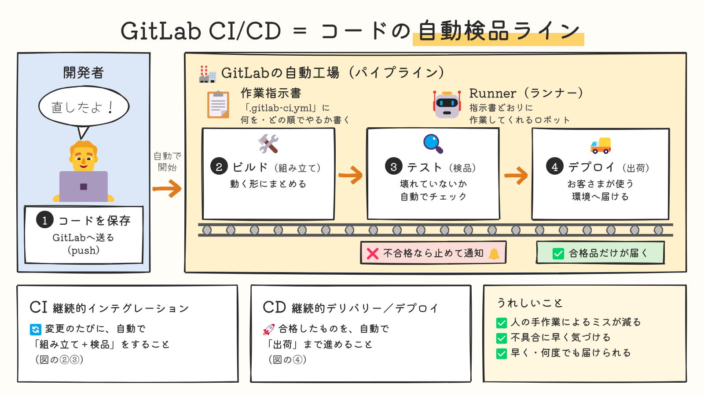
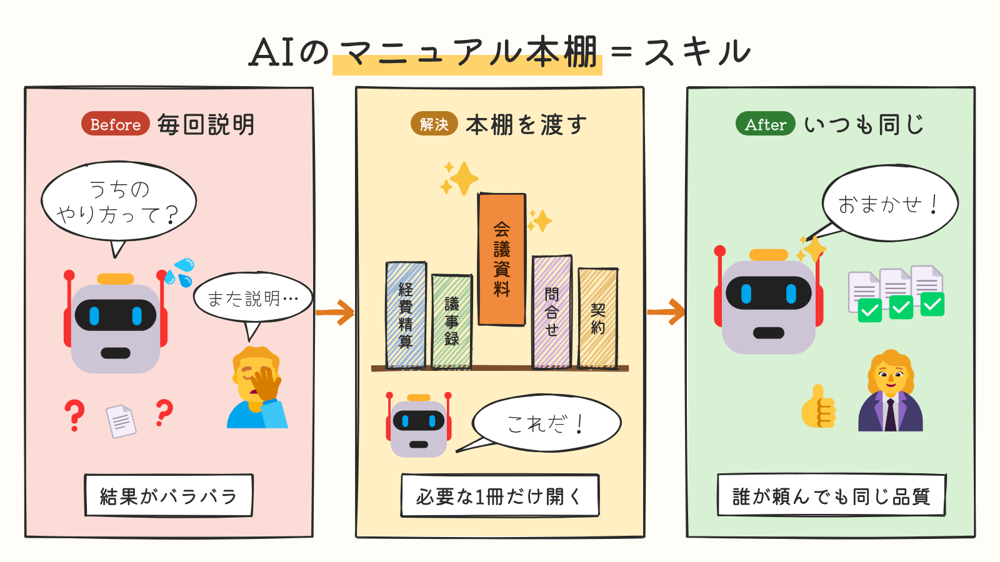
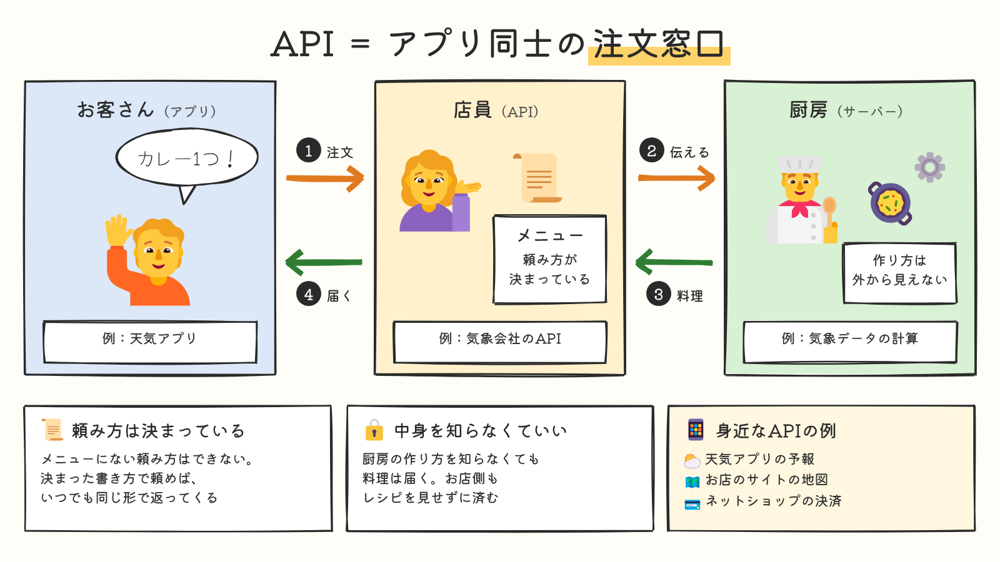
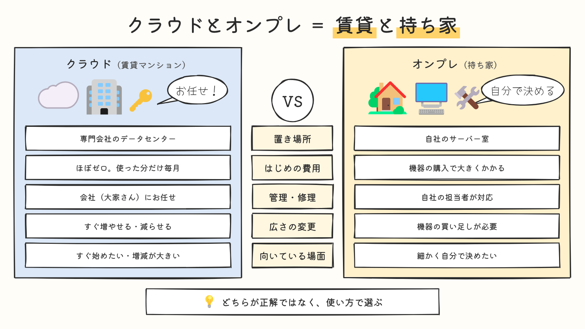

# zukai-explainer

専門的な仕組みや用語を、**非エンジニアにも伝わる手描き風イラストの説明図**（1枚のPNGとPDF）にするエージェントスキルです。

[Agent Skills](https://agentskills.io/) の仕様に沿って作られており、Claude Code・claude.ai などスキルに対応したAIエージェントで使えます。



## 特徴

- **たとえで伝える**：専門用語を、工場・本棚・料理店など身近な場面に置き換え、必ず「テスト（検品）」のようにペアで示します
- **文字は少なく、具体的に**：段落の説明文は書かず、見出し・短い説明・キャラクターのセリフで伝えます
- **内容に合わせてレイアウトを選ぶ**：Before→After、工程の流れ、左右比較など8つの型から選びます
- **はみ出しを自動で検出**：文字のはみ出し、吹き出しの重なり、窮屈な配置を書き出し時に警告し、エージェントが自分で直します
- **手元で完結**：外部の画像生成サービスは使いません。社内向けの説明資料にも使えます

## 作例

| Before→解決→After | 登場人物のやりとり | 左右比較 |
|---|---|---|
|  |  |  |
| エージェントスキル＝AIのマニュアル本棚 | API＝アプリ同士の注文窓口 | クラウドとオンプレ＝賃貸と持ち家 |

## 使い方

スキルを入れたら、エージェントに頼むだけです。

```
GitLabのCI/CDの仕組みを図解して
```

```
ITに詳しくない総務の人に「RPAって何？」を1枚の絵で説明したい。朝礼で投影する
```

エージェントは、伝えたいこと・聞き手・使う場面・たとえを決めてから図を組み立て、PNG（投影・スライド貼り付け用）とPDF（配布用）を返します。

## インストール

### Claude Code

```bash
git clone https://github.com/<owner>/zukai-explainer.git
cp -r zukai-explainer/skills/zukai-explainer ~/.claude/skills/
```

プロジェクト単位で使う場合は、プロジェクトの `.claude/skills/` に置きます。

### claude.ai

`skills/zukai-explainer` フォルダをzipに圧縮し、claude.aiの設定画面からスキルとしてアップロードします。

### その他のエージェント

多くのクライアントで共通の置き場所になっている `~/.agents/skills/`（またはプロジェクトの `.agents/skills/`）に、`skills/zukai-explainer` フォルダを置きます。

## 動作環境

| 必要なもの | バージョン |
|---|---|
| Python | 3.9以上 |
| Node.js | 18以上 |
| Chromium | Playwright経由で自動で入ります |

初回だけ、npmとPyPIからパッケージを取得します（ネットワーク接続が必要）。2回目以降はオフラインで動きます。

## 仕組み

```
HTMLで配置 → 絵文字の絵を差し込む → 手描き風の線を描く → ブラウザで撮影 → 自動チェック → 目で確認して直す
```

| 使っているもの | 役割 |
|---|---|
| [Fluent Emoji](https://github.com/microsoft/fluentui-emoji)（Flat） | 人物・ロボット・書類などの絵 |
| [Rough.js](https://roughjs.com/) | 枠・矢印・吹き出しを手描き風の線で描く |
| [Kiwi Maru](https://fonts.google.com/specimen/Kiwi+Maru)・[Yomogi](https://fonts.google.com/specimen/Yomogi) | 見出し・本文と、吹き出しのフォント |
| [Playwright](https://playwright.dev/python/) | ブラウザでPNG・PDFに書き出す |

## フォルダ構成

```
skills/zukai-explainer/
├── SKILL.md                 # スキル本体（手順・型・文字量・Gotchas）
├── scripts/
│   ├── setup.sh             # 作業フォルダの準備（パッケージ・ブラウザ）
│   ├── build.py             # PNG/PDF書き出しと自動チェック
│   └── find_emoji.py        # 絵文字名の検索
├── assets/
│   ├── base.html            # 図の雛形
│   ├── ink.js               # 手描き線の描画
│   └── examples/            # 型ごとの作例HTML
└── evals/
    ├── evals.json           # 出力品質の評価ケース
    └── trigger_queries.json # 発動判定の評価用の依頼文
```

スクリプトを直接使うこともできます。詳しくは各スクリプトの `--help` を見てください。

```bash
bash skills/zukai-explainer/scripts/setup.sh ./zukai-work
cp skills/zukai-explainer/assets/examples/process-flow.html ./zukai-work/my-diagram.html
python3 skills/zukai-explainer/scripts/build.py ./zukai-work/my-diagram.html
```

## 制限

- 絵文字の絵を使うため、キャラクターの表情や動作は変えられません（ロボットは1種類のみ）。感情はセリフや汗・はてなマークで、動作は矢印と配置で表します
- 画像生成AIのような描き込まれたイラストにはなりません
- 数値データのグラフ、複数枚のスライド、技術者向けの正確な構成図（UML・ネットワーク図など）は対象外です

## 評価

`evals/` にテストケースがあります。評価の進め方は [Evaluating skill output quality](https://agentskills.io/skill-creation/evaluating-skills) と [Optimizing skill descriptions](https://agentskills.io/skill-creation/optimizing-descriptions) を参照してください。

## サードパーティのライセンス

このリポジトリには以下を同梱していません。`setup.sh` の実行時にnpmから取得します。

| 名前 | ライセンス |
|---|---|
| Fluent Emoji（`@iconify-json/fluent-emoji-flat`） | MIT |
| Rough.js | MIT |
| Kiwi Maru・Yomogi（`@fontsource`） | SIL Open Font License 1.1 |
| Playwright | Apache License 2.0 |

`docs/images/` の作例画像にはFluent Emojiの絵が含まれます（MIT）。
